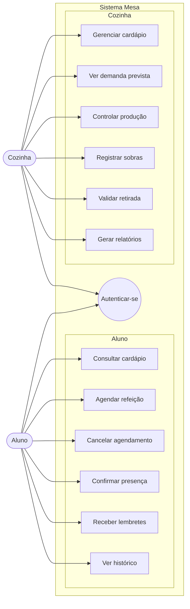
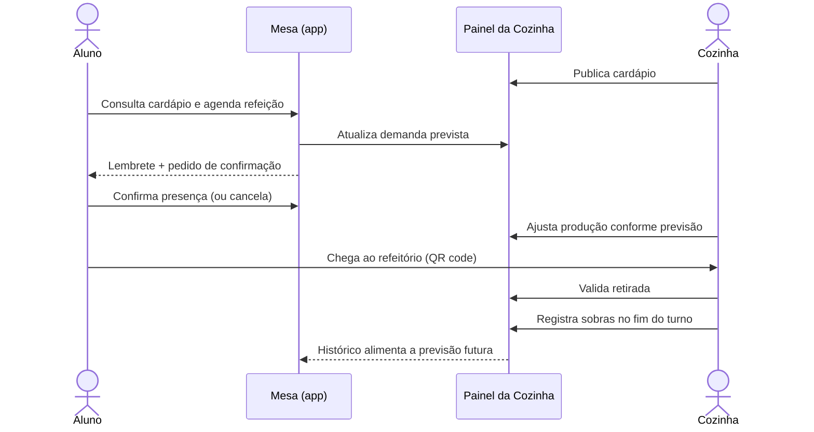
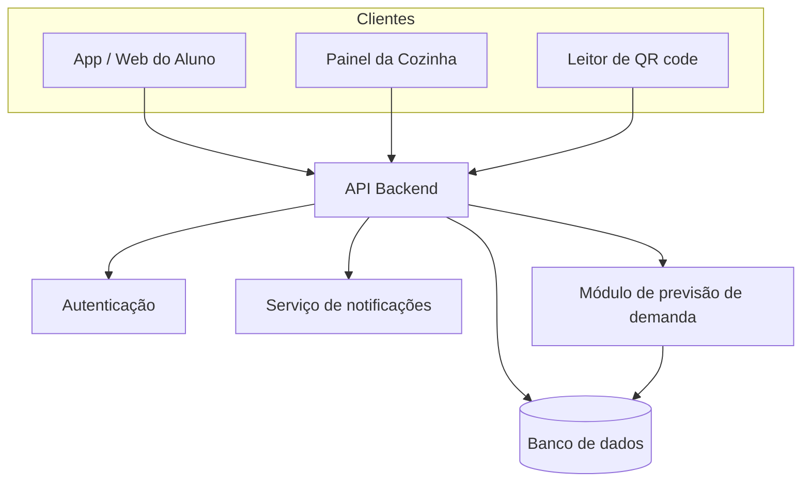
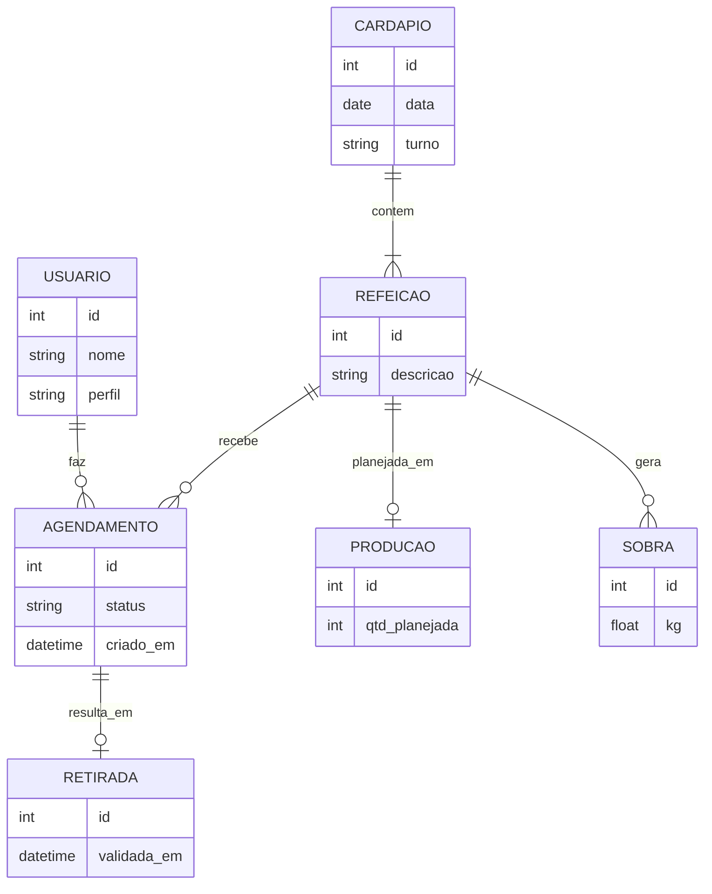

# Mesa Já

> **Participantes do Projeto:** 
> Isabella Saboia, Luis Eduardo

> **Produza o que vai ser consumido.**
> APLICATIVO de Agendamento de refeições para reduzir desperdício em restaurantes universitários e cantinas escolares.

---

##  Sumário

1. [Visão geral](#-visão-geral)
2. [O problema](#-o-problema)
3. [A solução](#-a-solução)
4. [Proposta de valor](#-proposta-de-valor)
5. [Atores e casos de uso](#-atores-e-casos-de-uso)
6. [Fluxo principal](#-fluxo-principal)
7. [Requisitos funcionais](#-requisitos-funcionais)
8. [Arquitetura proposta](#-arquitetura-proposta)
9. [Modelo de negócio (Lean Canvas)](#-modelo-de-negócio-lean-canvas)
10. [Métricas-chave](#-métricas-chave)
11. [Roadmap](#-roadmap)
12. [Riscos e hipóteses](#-riscos-e-hipóteses)
13. [Como contribuir](#-como-contribuir)
14. [Licença](#-licença)

---

##  Visão geral

O **Mesa** é um sistema que conecta quem come a quem cozinha. O aluno **agenda, cancela e confirma presença** nas refeições; a cozinha **enxerga a demanda prevista** e ajusta a produção. O resultado é menos sobra, menos falta, menos fila e menos custo.

**Conceito:** agendamento de refeições para reduzir desperdício.

---

##  O problema

| # | Problema | Consequência |
|---|----------|--------------|
| 1 | A cozinha produz **sem saber a demanda** | Produção no "achismo" |
| 2 | **Sobras sem registro** nem histórico | Impossível aprender com o passado |
| 3 | **Faltas e filas** na retirada | Má experiência e perda de tempo |
| 4 | O aluno **não tem previsibilidade do cardápio** | Decide sem informação |

**Alternativas atuais:** planilhas, papel e estimativa "no olho".

---

##  A solução

- **Agendar, cancelar e confirmar presença** nas refeições
-  **Lembretes e histórico** para o aluno
-  **Painel de demanda prevista** para a cozinha
-  **Controle de produção** alinhado à previsão
-  **Validar retirada e registrar sobras**, gerando dados reais

---

## Proposta de valor

> **Produza o que vai ser comido.**
> O aluno agenda, a cozinha prevê: menos sobra e menos custo.

### Vantagem competitiva

- **Ciclo completo no mesmo produto:** do agendamento ao registro de sobras
- **Histórico de dados que melhora a previsão** com o tempo
- **Baixa barreira de uso:** acesso simples, inclusive via QR code

---

##  Atores e casos de uso

O sistema tem dois atores. Ambos precisam **autenticar-se**.

### Aluno

| Caso de uso | Descrição |
|-------------|-----------|
| Consultar cardápio | Ver as refeições disponíveis por dia/turno |
| Agendar refeição | Reservar a refeição que pretende consumir |
| Cancelar agendamento | Liberar a reserva para a cozinha ajustar a produção |
| Confirmar presença | Reforçar a intenção de comparecer perto do horário |
| Receber lembretes | Notificações sobre agendamentos e confirmações |
| Ver histórico | Consultar refeições agendadas e retiradas |

### Cozinha

| Caso de uso | Descrição |
|-------------|-----------|
| Gerenciar cardápio | Cadastrar e editar o cardápio |
| Ver demanda prevista | Painel com a previsão por refeição/turno |
| Controlar produção | Planejar a quantidade a produzir |
| Registrar sobras | Anotar o que sobrou (kg) |
| Validar retirada | Confirmar que o aluno retirou a refeição |
| Gerar relatórios | Indicadores de adesão, sobra e previsão |

---

##  Fluxo principal

---

##  Requisitos funcionais

| ID | Requisito | Ator |
|----|-----------|------|
| RF01 | Autenticação de usuários | Ambos |
| RF02 | Consulta de cardápio | Aluno |
| RF03 | Agendamento de refeição | Aluno |
| RF04 | Cancelamento de agendamento | Aluno |
| RF05 | Confirmação de presença | Aluno |
| RF06 | Envio de lembretes (notificações) | Aluno |
| RF07 | Histórico de refeições | Aluno |
| RF08 | Gestão de cardápio | Cozinha |
| RF09 | Painel de demanda prevista | Cozinha |
| RF10 | Controle de produção | Cozinha |
| RF11 | Validação de retirada | Cozinha |
| RF12 | Registro de sobras | Cozinha |
| RF13 | Geração de relatórios | Cozinha |

> Requisitos não funcionais a detalhar: usabilidade (baixa barreira de uso), disponibilidade nos horários de pico, privacidade dos dados (LGPD) e desempenho em picos de agendamento.

---

##  Arquitetura proposta

### Módulos

| Módulo | Responsabilidade |
|--------|------------------|
| **Autenticação** | Login e perfis (aluno, cozinha) |
| **Cardápio** | Cadastro e consulta de refeições |
| **Agendamento** | Reservas, cancelamentos e confirmações |
| **Retirada** | Validação via QR code e registro de presença |
| **Produção e sobras** | Planejamento e registro de sobras |
| **Previsão** | Estimativa de demanda com base no histórico |
| **Notificações** | Lembretes e avisos |
| **Relatórios** | Indicadores para gestão |

### Modelo de dados (esboço)

---

## Modelo de negócio (Lean Canvas)

### 2. Segmentos de clientes

- **Quem paga:** restaurantes universitários e cantinas escolares
- **Usuários:** alunos e equipe da cozinha
- **Early adopter (hipótese):** RU com desperdício alto

### 5. Canais

- Venda direta à gestão, com piloto
- QR code no refeitório
- Centros acadêmicos
- Indicação entre unidades

### 6. Fontes de receita

- Assinatura mensal por instituição
- Plano premium: relatórios e integração com estoque *(hipótese)*
- Editais e convênios, se for projeto público

### 7. Estrutura de custos

- Desenvolvimento e manutenção (app + painel da cozinha)
- Hospedagem e envio de notificações
- Suporte e treinamento da equipe da cozinha
- Implantação e marketing nas instituições

---

## 📈 Métricas-chave

| Métrica | O que mede |
|---------|------------|
| **kg de sobra evitada** | Impacto direto no desperdício |
| **Adesão ao agendamento** | % de usuários que usam o sistema |
| **Agendado × retirado** | Taxa de comparecimento (confiabilidade) |
| **Precisão da previsão** | Diferença entre demanda prevista e real |

---

## Roadmap

- [ ] **Fase 0: Concepção:** Lean Canvas, casos de uso e arquitetura
- [ ] **Fase 1: MVP:** autenticação, cardápio, agendar/cancelar, painel de demanda simples
- [ ] **Fase 2: Ciclo completo:** confirmação de presença, lembretes, validação de retirada (QR code), registro de sobras
- [ ] **Fase 3: Inteligência:** previsão baseada em histórico e relatórios
- [ ] **Fase 4: Piloto:** implantação em um RU/cantina e coleta de métricas
- [ ] **Fase 5: Escala:** multiunidade, plano premium e integração com estoque

---

## Riscos e hipóteses

| Item | Tipo | Observação |
|------|------|------------|
| RU com desperdício alto como early adopter | Hipótese | Validar com piloto |
| Alunos adotarão o agendamento | Risco | Depende da baixa barreira de uso |
| Qualidade da previsão no início | Risco | Poucos dados nas primeiras semanas |
| Plano premium com integração a estoque | Hipótese | Validar disposição a pagar |
| Financiamento via editais/convênios | Hipótese | Depende de ser projeto público |
| Dados pessoais dos usuários | Risco | Adequação à LGPD |

---

## Como contribuir

1. Faça um fork do repositório
2. Crie uma branch: `git checkout -b feature/minha-feature`
3. Commit: `git commit -m "feat: minha feature"`
4. Push: `git push origin feature/minha-feature`
5. Abra um Pull Request

---

## Licença e autorizações

Equipe tech isa.

---

Feito para que menos comida vá para o lixo. 🌎

