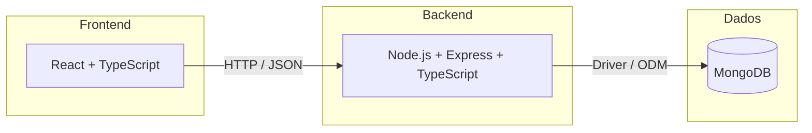
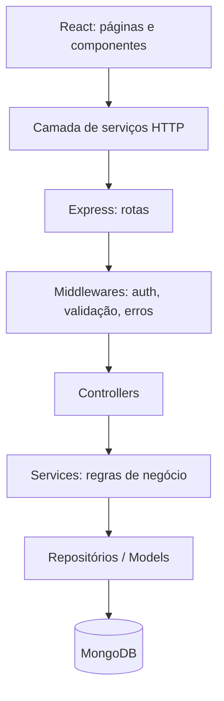

# 🧱 Stack Tecnológica do Mesa

Este documento descreve as tecnologias escolhidas para o **Mesa**, por que cada uma faz sentido para o projeto e como elas se encaixam.

> **Stack definida:** React · TypeScript · Node.js · Express · MongoDB
> (stack conhecida como **MERN** com TypeScript)

---

## 📑 Sumário

1. [Visão geral](#-visão-geral)
2. [Tecnologias](#-tecnologias)
3. [Por que essa stack para o Mesa](#-por-que-essa-stack-para-o-mesa)
4. [Arquitetura em camadas](#-arquitetura-em-camadas)
5. [Estrutura de pastas sugerida](#-estrutura-de-pastas-sugerida)
6. [Modelagem no MongoDB](#-modelagem-no-mongodb)
7. [Endpoints da API (esboço)](#-endpoints-da-api-esboço)
8. [Bibliotecas de apoio sugeridas](#-bibliotecas-de-apoio-sugeridas)
9. [Pontos de atenção](#-pontos-de-atenção)
10. [Ambiente de desenvolvimento](#-ambiente-de-desenvolvimento)

---

## 🔭 Visão geral



| Camada | Tecnologia | Papel no Mesa |
|--------|------------|---------------|
| Interface | **React** | App do aluno e painel da cozinha |
| Linguagem | **TypeScript** | Tipagem estática em front e back |
| Runtime | **Node.js** | Execução do servidor |
| Framework web | **Express** | API REST |
| Banco de dados | **MongoDB** | Persistência de agendamentos, cardápios, sobras etc. |

---

## 🛠️ Tecnologias

### ⚛️ React

Biblioteca para construção de interfaces baseadas em componentes.

**No Mesa Já serve para:**
- App do **Aluno**: cardápio, agendamento, confirmação, histórico
- Painel da **Cozinha**: demanda prevista, produção, sobras, relatórios
- Interface leve e responsiva (uso no celular, via QR code no refeitório)

**Vantagens:**
- Componentização: reaproveitar cards de refeição, listas e formulários nos dois perfis
- Ecossistema grande (roteamento, gerenciamento de estado, gráficos)
- Fácil de transformar em PWA, ajudando na "baixa barreira de uso"

---

### 🔷 TypeScript

Superconjunto de JavaScript com tipagem estática.

**No Mesa serve para:**
- Compartilhar **tipos** entre front e back (ex.: `Agendamento`, `Refeicao`, `Usuario`)
- Reduzir bugs em regras sensíveis (status de agendamento, cancelamento, retirada)
- Melhorar autocompletar e refatoração conforme o projeto cresce

**Exemplo de tipo compartilhado:**

```ts
export type StatusAgendamento =
  | "agendado"
  | "confirmado"
  | "cancelado"
  | "retirado"
  | "faltou";

export interface Agendamento {
  id: string;
  usuarioId: string;
  refeicaoId: string;
  status: StatusAgendamento;
  criadoEm: string; // ISO 8601
}
```

---

### 🟢 Node.js

Ambiente de execução JavaScript no servidor.

**No Mesa serve para:**
- Rodar a API e tarefas agendadas (lembretes, fechamento de agendamentos)
- Usar a **mesma linguagem** no front e no back, facilitando o trabalho em equipe

**Vantagens:**
- I/O não bloqueante, adequado para muitas requisições curtas em horários de pico (ex.: abertura do agendamento)
- Grande ecossistema via npm

---

### 🚂 Express

Framework minimalista para criar APIs em Node.js.

**No Mesa serve para:**
- Expor a **API REST** consumida pelo React
- Organizar rotas, middlewares de autenticação, validação e tratamento de erros

**Vantagens:**
- Simples, flexível e muito documentado
- Fácil de estruturar em camadas (rotas → controllers → services → repositórios)

---

### 🍃 MongoDB

Banco de dados NoSQL orientado a documentos.

**No Mesa serve para:**
- Armazenar cardápios, agendamentos, retiradas, produção e sobras como documentos JSON-like
- Guardar o **histórico** que alimentará a previsão de demanda

**Vantagens:**
- Esquema flexível, bom para evoluir rápido na fase de MVP
- Consultas de agregação (`aggregate`) úteis para relatórios e métricas (kg de sobra, adesão, agendado × retirado)
- Índices por data/turno para consultas rápidas do painel

---

## 🎯 Por que essa stack para o Mesa

| Necessidade do projeto | Como a stack atende |
|------------------------|---------------------|
| MVP rápido | Uma só linguagem (TypeScript) no projeto inteiro |
| Dois perfis de usuário (Aluno e Cozinha) | React com rotas e permissões por perfil |
| Uso no celular, sem instalar nada | React responsivo / PWA + QR code |
| Muitos agendamentos em horários de pico | Node.js com I/O assíncrono |
| Relatórios e métricas | Aggregation pipeline do MongoDB |
| Evolução do modelo de dados | Esquema flexível do MongoDB |
| Equipe pequena | Stack popular, com muita documentação e comunidade |

---

## 🧩 Arquitetura em camadas



| Camada | Responsabilidade |
|--------|------------------|
| **Rotas** | Mapear URL e método HTTP para um controller |
| **Middlewares** | Autenticação, autorização por perfil, validação de entrada, erros |
| **Controllers** | Receber a requisição e devolver a resposta |
| **Services** | Regras de negócio (ex.: não permitir agendar após o limite) |
| **Repositórios/Models** | Acesso ao MongoDB |

---

## 📂 Estrutura de pastas sugerida

```text
mesa/
├── README.md
├── STACK.md
├── packages/
│   └── shared/                  # tipos e constantes compartilhados
│       └── src/types.ts
├── backend/
│   ├── package.json
│   ├── tsconfig.json
│   └── src/
│       ├── app.ts               # configuração do Express
│       ├── server.ts            # inicialização
│       ├── config/              # env, conexão com o banco
│       ├── modules/
│       │   ├── auth/
│       │   ├── cardapio/
│       │   ├── agendamento/
│       │   ├── retirada/
│       │   ├── producao/
│       │   ├── sobras/
│       │   └── relatorios/
│       ├── middlewares/
│       └── utils/
└── frontend/
    ├── package.json
    ├── tsconfig.json
    └── src/
        ├── main.tsx
        ├── routes/
        ├── pages/
        │   ├── aluno/
        │   └── cozinha/
        ├── components/
        ├── services/            # chamadas à API
        ├── hooks/
        └── contexts/            # autenticação, tema etc.
```

> Cada módulo do backend segue o padrão `*.routes.ts`, `*.controller.ts`, `*.service.ts` e `*.model.ts`.

---

## 🗄️ Modelagem no MongoDB

### Coleções

| Coleção | Conteúdo |
|---------|----------|
| `usuarios` | Dados de login e perfil (`aluno` ou `cozinha`) |
| `cardapios` | Cardápio por data e turno, com as refeições |
| `agendamentos` | Reserva do aluno para uma refeição |
| `retiradas` | Validação da retirada pela cozinha |
| `producoes` | Quantidade planejada por refeição/turno |
| `sobras` | Registro de sobras (kg) por refeição/turno |

### Exemplo: documento de agendamento

```json
{
  "_id": "665f1c...",
  "usuarioId": "665f0a...",
  "cardapioId": "665f1b...",
  "turno": "almoco",
  "data": "2026-11-03",
  "status": "confirmado",
  "criadoEm": "2026-10-30T14:20:00Z",
  "confirmadoEm": "2026-11-03T10:05:00Z"
}
```

### Índices recomendados

```js
// Painel da cozinha: demanda por data e turno
db.agendamentos.createIndex({ data: 1, turno: 1, status: 1 });

// Histórico do aluno
db.agendamentos.createIndex({ usuarioId: 1, data: -1 });

// Evitar agendamento duplicado do mesmo aluno no mesmo turno
db.agendamentos.createIndex(
  { usuarioId: 1, data: 1, turno: 1 },
  { unique: true, partialFilterExpression: { status: { $ne: "cancelado" } } }
);
```

### Exemplo: demanda prevista por turno (aggregation)

```js
db.agendamentos.aggregate([
  { $match: { data: "2026-11-03", status: { $in: ["agendado", "confirmado"] } } },
  { $group: { _id: "$turno", total: { $sum: 1 } } }
]);
```

---

## 🔌 Endpoints da API (esboço)

| Método | Rota | Ator | Caso de uso |
|--------|------|------|-------------|
| `POST` | `/auth/login` | Ambos | Autenticar-se |
| `GET` | `/cardapios?data=` | Aluno | Consultar cardápio |
| `POST` | `/agendamentos` | Aluno | Agendar refeição |
| `PATCH` | `/agendamentos/:id/cancelar` | Aluno | Cancelar agendamento |
| `PATCH` | `/agendamentos/:id/confirmar` | Aluno | Confirmar presença |
| `GET` | `/agendamentos/meus` | Aluno | Ver histórico |
| `POST` | `/cardapios` | Cozinha | Gerenciar cardápio |
| `GET` | `/demanda?data=&turno=` | Cozinha | Ver demanda prevista |
| `POST` | `/producoes` | Cozinha | Controlar produção |
| `POST` | `/retiradas` | Cozinha | Validar retirada |
| `POST` | `/sobras` | Cozinha | Registrar sobras |
| `GET` | `/relatorios` | Cozinha | Gerar relatórios |

---

## 📦 Bibliotecas de apoio sugeridas

> ⚠️ Sugestões para discussão. Nada além das cinco tecnologias principais foi decidido.

### Backend

| Biblioteca | Uso |
|-----------|-----|
| **Mongoose** | ODM para modelar e validar documentos no MongoDB |
| **Zod** | Validação de entrada, com tipos inferidos para TypeScript |
| **jsonwebtoken** + **bcrypt** | Autenticação com JWT e hash de senhas |
| **dotenv** | Variáveis de ambiente |
| **cors** / **helmet** | Segurança básica da API |
| **node-cron** | Tarefas agendadas (lembretes, fechamento de turnos) |
| **tsx** ou **ts-node-dev** | Execução em desenvolvimento |
| **Jest** + **Supertest** | Testes da API |

### Frontend

| Biblioteca | Uso |
|-----------|-----|
| **Vite** | Bundler e servidor de desenvolvimento |
| **React Router** | Rotas e áreas separadas para aluno e cozinha |
| **TanStack Query** | Cache e sincronização de dados da API |
| **React Hook Form** + **Zod** | Formulários com validação |
| **Recharts** | Gráficos do painel da cozinha |
| **Vitest** + **Testing Library** | Testes de componentes |

### Qualidade de código

| Ferramenta | Uso |
|-----------|-----|
| **ESLint** | Padrão de código |
| **Prettier** | Formatação |
| **Husky** + **lint-staged** | Checagens antes do commit |

---

## ⚠️ Pontos de atenção

- **Regras de concorrência:** no horário de pico, dois agendamentos simultâneos podem violar limites. Use índices únicos e, quando necessário, transações do MongoDB (exigem *replica set*).
- **Consistência entre coleções:** MongoDB não tem chaves estrangeiras. Garanta integridade (ex.: agendamento apontando para cardápio existente) na camada de service.
- **Relacionamentos:** os dados do Mesa são bem relacionais (usuário ↔ agendamento ↔ refeição). Funciona bem no MongoDB com referências, mas evite aninhar demais documentos que mudam com frequência.
- **Previsão de demanda:** no início, pode ser uma média histórica calculada via aggregation. Modelos mais sofisticados ficam para fases posteriores.
- **LGPD:** armazenar o mínimo de dados pessoais, proteger senhas com hash e definir política de retenção do histórico.
- **Segurança:** validar toda entrada, aplicar autorização por perfil (aluno não acessa rotas da cozinha) e limitar requisições (*rate limit*).

---

## 💻 Ambiente de desenvolvimento

### Pré-requisitos

- Node.js (versão LTS)
- npm ou pnpm
- MongoDB local ou conta no MongoDB Atlas

### Variáveis de ambiente (backend)

```env
PORT=3333
MONGODB_URI=mongodb://localhost:27017/mesa
JWT_SECRET=troque-este-valor
JWT_EXPIRES_IN=1d
```

### Executando

```bash
# Backend
cd backend
npm install
npm run dev

# Frontend (em outro terminal)
cd frontend
npm install
npm run dev
```

### Scripts esperados

| Script | Função |
|--------|--------|
| `npm run dev` | Desenvolvimento com recarga automática |
| `npm run build` | Compilar TypeScript |
| `npm start` | Executar a versão compilada |
| `npm test` | Rodar os testes |
| `npm run lint` | Verificar o código |

---

<p align="center">Stack escolhida para entregar rápido e evoluir com segurança. 🚀</p>
